# `whoami`

**Márk Sági-Kazár**

_Cloud Native Ambassador_

_Dagger Commander_

<br>
**YAML engineer for life** 😭

<br>
<br>

[@sagikazarmark](https://twitter.com/sagikazarmark)

[https://sagikazarmark.com](https://sagikazarmark.com)

[hello@sagikazarmark.com](mailto:hello@sagikazarmark.com)

{.absolute top=0 right=0 width="300"}
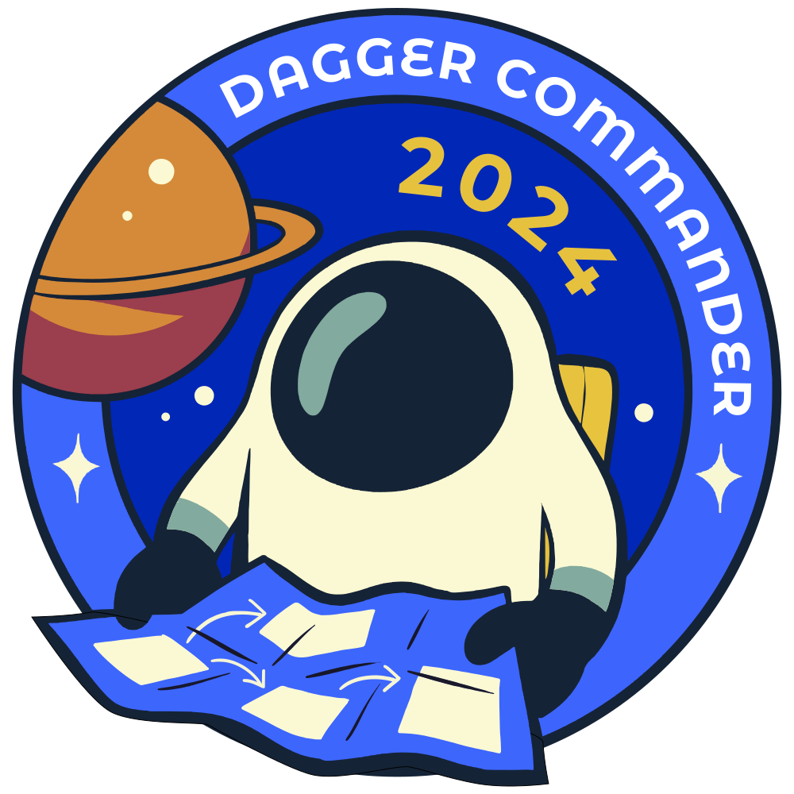{.absolute top=350 right=0 width="300"}

# _CI/CD is broken... 🔥_

::: {.fragment}
...and we don't care anymore
:::

# 🔀 Environment drift

## Developer environment

```sh
brew install go
nix-env -i gotestsum
sudo apt-get install golangci-lint

make build
just test
task lint
```

::: {.fragment}
::: {.callout-important appearance="minimal"}
**What version of Go did you just install?**
:::
:::

::: {.notes}
Consistent onboarding experience?
:::

## CI/CD environment

```{.yaml code-line-numbers="|3,10"}
- uses: actions/setup-go@v5
  with:
    go-version: "1.24.0"

- run: go build .
- run: go test -race -v ./…

- uses: golangci/golangci-lint-action@v8
  with:
    version: "v2.1.0"
```

::: {.notes}
- custom, vendor-specific format
- different from dev scripts
:::

## Artifacts

```{.dockerfile code-line-numbers="|1"}
FROM golang:1.23 AS go

RUN go build -o app .


FROM alpine

COPY --from=go /app /usr/local/bin/
```

::: {.notes}
- different from dev and CI scripts
:::

## Why is this a problem?

:::: {.columns .v-center-container}

::: {.column width="50%"}
- Maintenance burden
- Hidden bugs
- Undermines trust in processes ^["it always fails, just ignore it"]
- Onboarding friction
:::

::: {.column width="50%"}
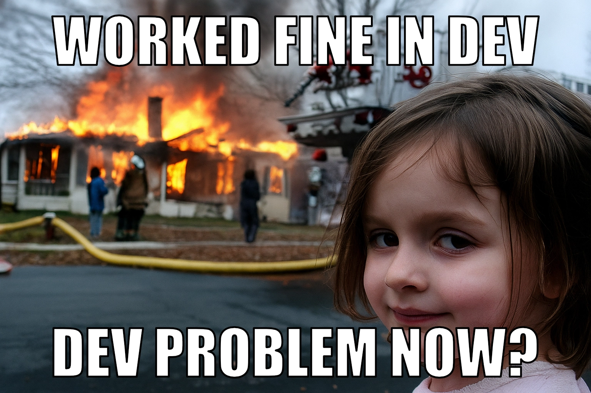{fig-align="center"}
:::

::::

## 💡 Portable environments

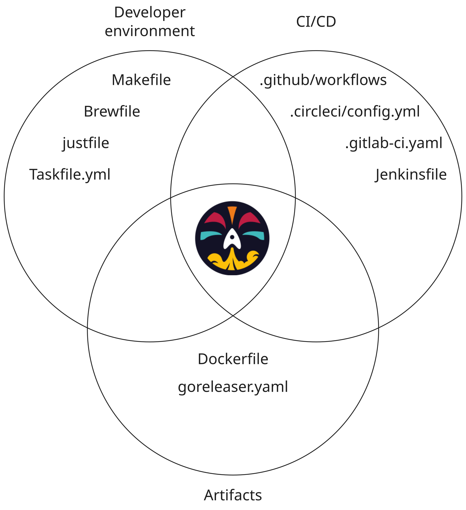{fig-align="center"}

Dev + CI/CD + Artifacts = software delivery pipelines/workflows

::: {.notes}
CI becomes a quality gate
:::

## I wish there was...

## {#containers}

{fig-align="center"}

## Is `docker run` the answer?

::: {.fragment}
It gives you containers...
:::

::: {.fragment}
...but not workflows.
:::

::: {.notes}
There is a missing piece.
:::

# 🙏 Push'n'Pray

## {#pushnpray-code transition="fade"}

{fig-align="center"}

## {#pushnpray-commit transition="fade"}

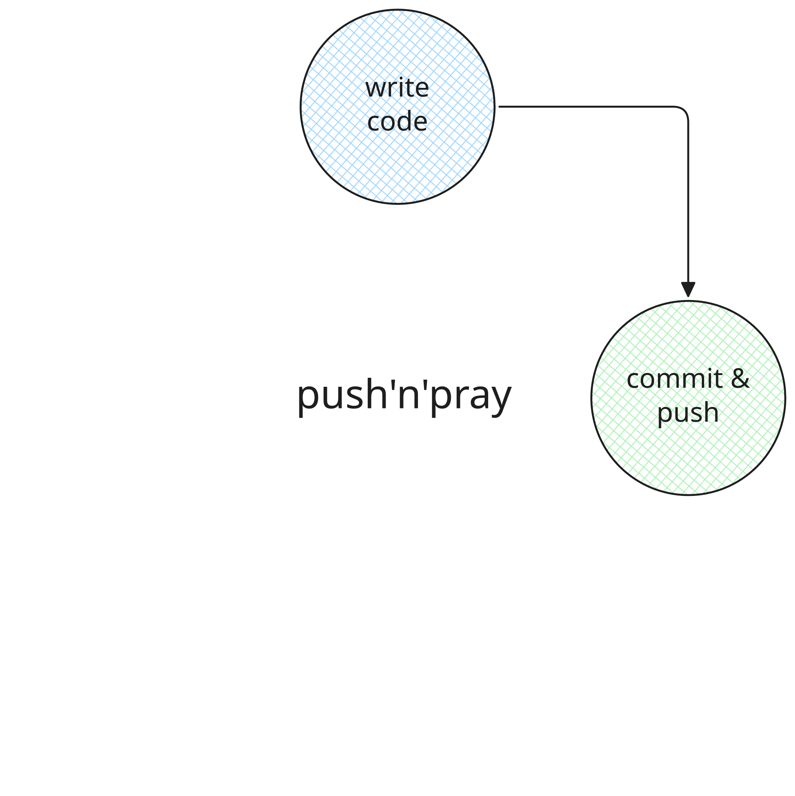{fig-align="center"}

## {#pushnpray-wait transition="fade"}

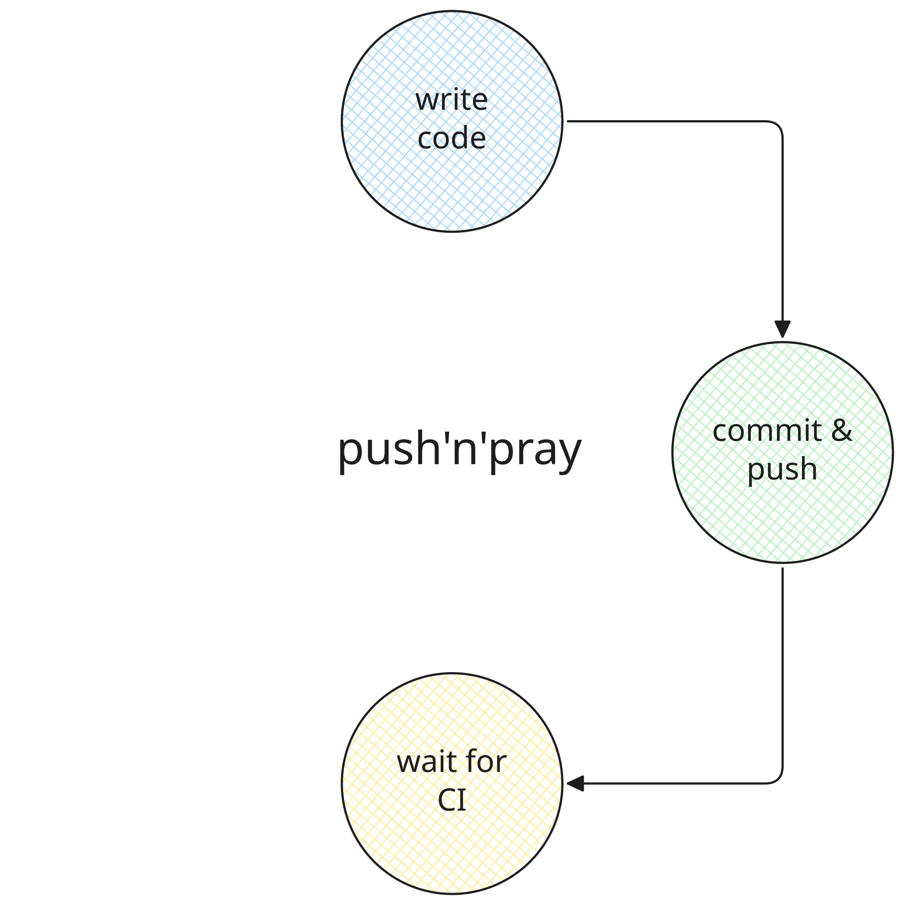{fig-align="center"}

## {#pushnpray-eternity background-image="assets/eternity.webp" background-transition="slide" background-transition-speed="fast"}

## {#pushnpray-fail}

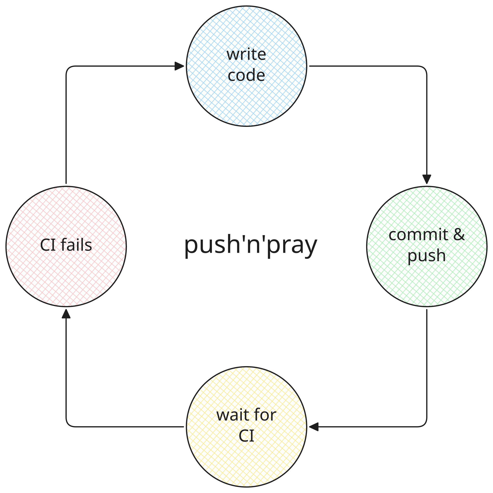{fig-align="center"}

## {#pushnpray-github background-color="black" background-image="assets/pushnpray.webp" background-transition="fade"}

## {#pushnpray-pain visibility="hidden"}

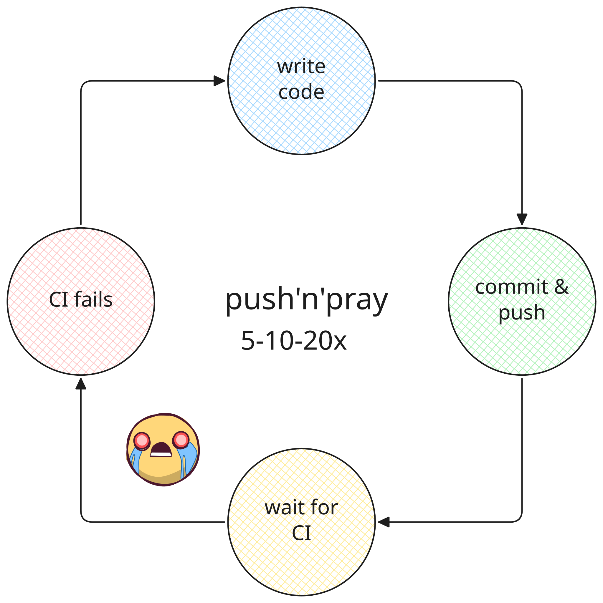{fig-align="center"}

## {#nopushnpray-code transition="fade-out"}

{fig-align="center"}

## {#nopushnpray-profit transition="fade"}

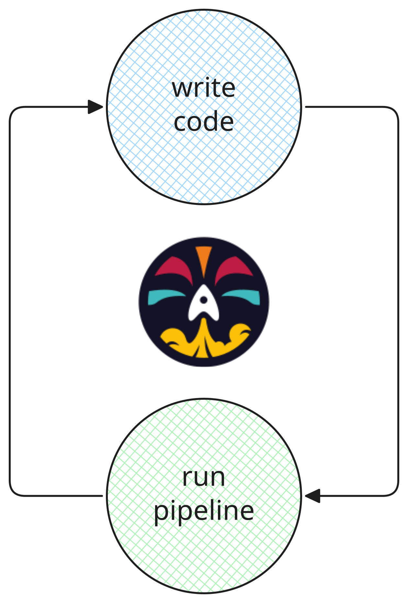{fig-align="center"}

## 💡 Portable workflows

Run the same workflow:

- in dev
- in CI
- anywhere

::: {.notes}
No more Push'n'Pray

- ⌛ Shorter feedback loop
- 💸 Less CI resources wasted ^[Planet Earth sends her regards]
- 🤯 You maintain your sanity
:::

# ✍️ YAML

## Day 1...

```yaml
name: CI

on:
  push:
    branches: [main]

jobs:
  build:
    runs-on: ubuntu-latest
    steps:
      - uses: actions/checkout@v5
      - run: |
          build
          test
          lint
```

## Day 101

700+ lines of YAML & Bash chaos

```yaml
# Foobar pipeline
# Include the Common CI pipeline parameters.
include:
  - project: 'foo/bar/foobarproject/cicdtemplate'
    file: '/Common.gitlab-ci.yml'
  #- /force-app/ui-tests/pipeline.yml

stages:
  - build-metadata-package
  - run-js-tests
  - validate-package
  - deploy-package
  - run-unit-tests
  - run-api-tests
  - run-ui-tests
  - integration

####################################################
# Builds the Metadata Package, builds the Package
# files and Destructive changes
####################################################
build-metadata-package:
  stage: build-metadata-package
  except:
    ...
```

## 🤔 How did we end up in this mess?

::: {.incremental}
- YAML is a _data serialization_ language
- Workflows are not strictly declarative
:::

## YAML...

- is not reusable ^[Anchors don't count]
- is not composable
- provides poor control flow
- is not portable (vendor lock-in)

::: {.callout-important appearance="minimal"}
**YAML is a poor choice of language for software delivery workflows.**
:::

## Example: Control Flow {visibility="hidden"}

:::: {.columns}

::: {.column width="55%"}
```yaml
steps:
- uses: haya14busa/action-cond@v1
  id: release
  with:
    cond: ${{ github.event_name == 'tag' }}
    if_true: "true"
    if_false: "false"
- name: Do something
  run: echo "${{ steps.release.outputs.value }}"
```
:::

::: {.column width="45%"}
```go
if release {
    // do something
} else {
    // do something else
}
```
:::

::::

## How about using a _real_ programming language?

::: {.notes}
Stop treating software pipelines as configuration.
:::

## How about using a programming language _you already know_?

## Example (pseudo code)

```go
func build() Binary {
    return go.Build(".")
}

func push() {
    ctr := newContainer().
        copy("/app", build())

    pushContainer(ctr)
}
```

# 🤖 AI

## {#aitoday}

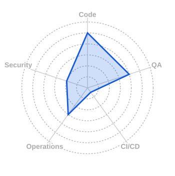{fig-align="center"}

## How can AI help?

- Fix tests and open PRs
- Find vulnerable dependencies and update them
- Make sure your code is in line with coding standards

## But how?

- GitHub Actions?
- Custom scripts?

## 💡 AI Native workflows

- Integrate AI into your workflow code
- Once again: portable workflows are king

# 👍 Ideal solution

:::: {.columns}

::: {.column width="50%"}
~~🔀 Environment drift~~

~~🙏 Push'n'Pray~~

~~✍️ YAML~~

🤖 AI
:::

::: {.column width="50%"}
→ Portable environments

→ Portable workflows

→ Programmable workflows

→ AI Native workflows
:::

::::

# {#dagger .nostretch background-color="#030525" background-transition="slide"}

{fig-align="center"}

## Dagger Functions

- Write your workflows as code...
- ...in a programming language you already know
- Orchestrate containers
- Run them anywhere ^[Where you can run containers]
- Use them as AI agents

## Dagger Function Example

::: {.panel-tabset}

### Go

```go
func (m *Module) Build() *dagger.File {
    return dag.Container().
        From("golang").
        WithExec([]string{"go", "build", "-o", "app", "."}).
        File("/app")
}
```

### Python

```python
@function
def build(self) -> dagger.Container:
    return dag.container().
        from("golang").
        with_exec(["go", "build", "-o", "app", "."]).
        file("/app")
```

### TypeScript

```typescript
  @func()
  build(): Container {
    return dag.container().
      from("golang").
      withExec(["go", "build", "-o", "app", "."]).
      file("/app")
  }
```

:::

## Dagger AI Example

```go
func (m *Module) Test() error {
    err := m.runTests()
    if err != nil {
        env := dag.Env().
            WithStringInput("error", err.Error(), "error message for the test")
            WithDirectoryInput("source", source, "source code").
            WithDirectoryOutput("fixed", "fixed code")

        work := dag.LLM().
            WithEnv(env).
            WithPrompt("My tests failed with $error. Fix them!")

        // Contains the fixed code
        work.Env().Output("fixed").Directory()
    }

    return nil
}
```

## {#dagger-function-flow}

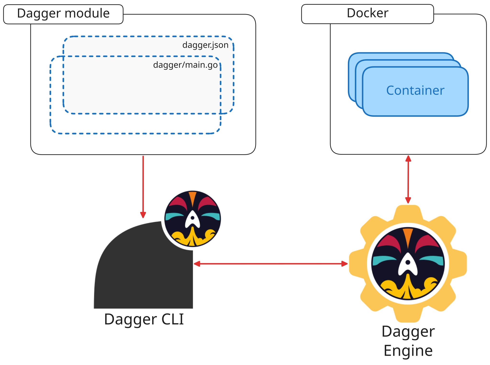{fig-align="center"}

## More features

- Reusable modules
- Caching
- Integration with secret providers
- Tracing

# Demo

# 🔭 Dagger in the Wild

[github.com/openmeterio/openmeter](https://github.com/openmeterio/openmeter)

[github.com/twirphp/twirp](https://github.com/twirphp/twirp)

[github.com/sagikazarmark/daggerverse](https://github.com/sagikazarmark/daggerverse)

# Any questions?

# 👋 Thank you

Stay in touch!

<br>
<br>

[@sagikazarmark](https://twitter.com/sagikazarmark)

[https://sagikazarmark.com](https://sagikazarmark.com)

[hello@sagikazarmark.com](mailto:hello@sagikazarmark.com)

# 🎮 Game {visibility="uncounted"}

::: {.fragment}
Guess which image is AI generated.
:::

## {#game-img1 visibility="uncounted"}

:::: {.columns .v-center-container}

::: {.column width="50%"}
{.lightbox fig-align="center"}
:::

::: {.column width="50%"}
::: {.fragment fragment-index=1}
{.lightbox fig-align="center"}
:::
:::

::::

::: {.fragment fragment-index=1}
:::: {.columns .v-center-container}

::: {.column width="50%"}
AI generated
:::

::: {.column width="50%"}
Original
:::

::::
:::

## {#game-img2 visibility="uncounted"}

:::: {.columns .v-center-container}

::: {.column width="50%"}
{fig-align="center"}
:::

::: {.column width="50%"}
::: {.fragment}
AI generated
:::
:::

::::

## {#game-img3 visibility="uncounted"}

:::: {.columns .v-center-container}

::: {.column width="50%"}
{.lightbox fig-align="center"}
:::

::: {.column width="50%"}
::: {.fragment fragment-index=1}
{.lightbox fig-align="center"}
:::
:::

::::

::: {.fragment fragment-index=1}
:::: {.columns .v-center-container}

::: {.column width="50%"}
AI generated
:::

::: {.column width="50%"}
Original
:::

::::
:::

## {#game-img4 visibility="uncounted"}

:::: {.columns .v-center-container}

::: {.column width="50%"}
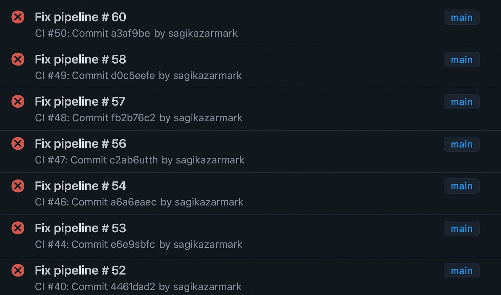{.lightbox fig-align="center"}
:::

::: {.column width="50%"}
::: {.fragment fragment-index=1}
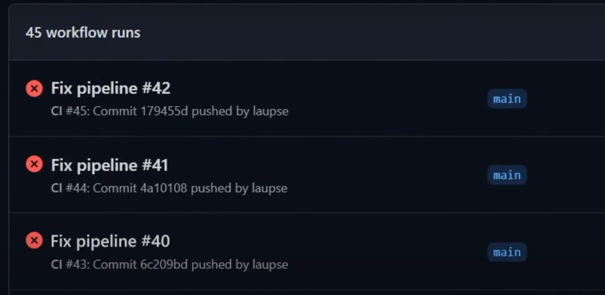{fig-align="center"}
:::
:::

::::

::: {.fragment fragment-index=1}
:::: {.columns .v-center-container}

::: {.column width="50%"}
AI generated
:::

::: {.column width="50%"}
Original
:::

::::
:::

## {#game-img4 visibility="uncounted"}

:::: {.columns .v-center-container}

::: {.column width="50%"}
{fig-align="center"}
:::

::: {.column width="50%"}
::: {.fragment}
Human generated
:::
:::

::::

## 🎮 Thanks for playing! {visibility="uncounted"}
